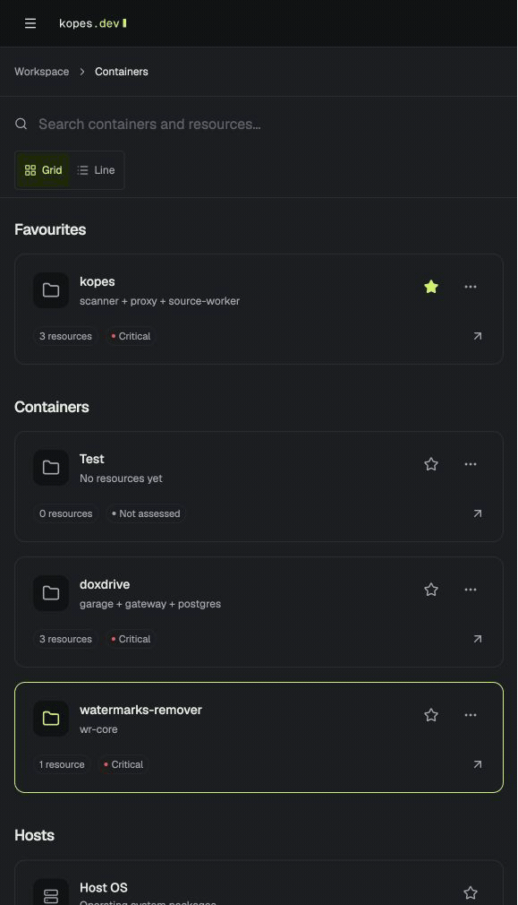

# kopes.dev

## Your app shipped. Its vulnerabilities keep changing.

Yesterday's deployment can pick up a newly disclosed vulnerability today,
even if you haven't changed a line of code. Your app still responds, your
containers still run, and the vulnerable package stays in place until you update it.

**Kopes helps solo developers and small teams see what needs attention on their
Docker or Coolify VPS.** Install it on the server you want to scan, then review
known vulnerabilities in its container images and supported Linux host packages
from one dashboard. Docker containers are opt-in: as an administrator, open
**Containers → Add container** and choose a running container.
Restarting the same container keeps it selected. After a redeploy, Kopes follows
an unambiguous replacement with the same stable Compose or Coolify identity.
If that identity is missing or ambiguous, add the replacement manually. To stop tracking a running or stopped container,
open **Containers → Untrack container**. This keeps its scan history and leaves
Docker untouched. Host OS scanning is separate; hosts aren't listed in Containers.

- **Find the affected app.** Search the container list and open a report directly.
- **Work out the next step.** Open a finding for affected packages, reported fixed
  versions, and remediation guidance you can review before updating and redeploying.
- **Keep checking after launch.** Schedule rescans and use Pulse to see newly
  detected vulnerabilities and newly available fixes.

Kopes uses Trivy for scanning. It reports findings and suggests next steps;
you stay in control of changes to your server.

**[Install with Coolify](#install-with-coolify-recommended)** ·
[Install on a standalone VPS](#one-command-vps-installer) ·
[Help shape Kopes](#help-shape-kopes)



*A 23-second walkthrough captured from the local app: find a resource, inspect a
vulnerability, and review the steps to update, redeploy, and verify.*

### Help shape Kopes

The most useful contributions right now are **feature requests, real-world
testing, and bug reports**. Try it on your setup and tell us where it falls short.

- [Request a feature](https://github.com/Mechse/kopes-scanner/issues/new?title=Feature%20request%3A%20).
  Describe the task you're trying to finish and how you handle it today.
- [Report a bug or share test results](https://github.com/Mechse/kopes-scanner/issues/new?title=Real-world%20feedback%3A%20).
  Include your OS, Docker/Coolify version, installation method, what you expected,
  and what happened. Remove secrets and private details from logs or screenshots.

Want to work on the code? Start with the [development guide](#operate--develop).
The app uses TanStack Start, Trivy, Better Auth, SQLite, Tailwind, and Radix
components. This repository includes its own logo and light/dark design tokens.

## License

The scanner's original code is source-available under
[PolyForm Shield 1.0.0](LICENSE), not an OSI-approved open-source license. Internal
business use is permitted; providing competing products or services is restricted,
even when they are free. The full license controls, including its exceptions.
Third-party dependencies retain their own licenses; see [THIRD_PARTY_NOTICES.md](THIRD_PARTY_NOTICES.md).

## Install with Coolify (recommended)

Use **Public Repository → Docker Compose** on the Linux server you want to scan.
No host Node installation, setup script, `.env` upload or external database is
needed. Both images build directly from this repository.

1. Point a domain such as `security.example.com` at your Coolify server. In your
   project/environment, add a **Public Repository**, paste this repository's HTTPS
   GitHub URL, and select your branch.
2. Select the **Docker Compose** build pack/strategy, base directory `/`, and
   Compose location `/compose.yaml`. Save/load the Compose configuration. Do not
   use the Dockerfile-only build pack: it omits the Docker proxy and host mounts.
3. Assign **only `scanner`** the domain `https://security.example.com:3100`.
   The `:3100` tells Coolify which internal port to route to; your browser URL is
   still `https://security.example.com` (no port). Do not assign a domain to
   `socket-proxy`; leave **Connect to predefined network** off.
4. Deploy with no OAuth credentials. Coolify generates `SERVICE_PASSWORD_64_AUTH`
   for the persistent auth secret and `SERVICE_URL_SCANNER_3100` from the domain.
   Check that `BETTER_AUTH_URL` resolves to your browser HTTPS origin, without
   `:3100`, a path or a callback suffix. Set it explicitly if necessary. Preserve
   the secret across redeploys.
5. Open your browser URL. The setup guide defaults to GitHub and has a dropdown
   for Google and Microsoft, with registration links, callback URLs and required
   environment variables. Add the settings in Coolify and redeploy. OAuth values
   are optional for building and starting the app. Make supplied values available
   to Compose and the running application.
6. Sign in as the configured administrator. Open **User access** to grant/revoke
   access. Members can view scans, download SBOMs and request scans.

The scanner reads container names and labels from Docker, not the Coolify API.
If upgrading from the old connection, revoke the scanner’s API token in Coolify
and remove it from your deployment environment. Previously resolved group names
may change; check custom scan settings under the new names. Scan history is retained.

### Sign-in providers

Configure the first provider through the deployment environment. After signing in
as an administrator, open **Settings → Sign-in methods** to add or manage GitHub,
Google and Microsoft credentials and copy their callback URLs. You still create the OAuth application in
each provider’s dashboard.

Saved settings take effect immediately and override deployment values. Client
secrets are stored encrypted in SQLite using
`BETTER_AUTH_SECRET`; keep that secret and the data volume when redeploying. Blank
secret fields retain the saved value; changing a client ID requires a new secret.
Disabling a provider also overrides its environment configuration. Saving does not
verify credentials: try a new sign-in to confirm access.

The method used for your current session cannot be changed or disabled. Sign in
through another method before editing it, so an untested configuration cannot
replace your only working method.

| Provider | Environment variables | Callback path |
| --- | --- | --- |
| GitHub | `GITHUB_CLIENT_ID`, `GITHUB_CLIENT_SECRET`, `GITHUB_ADMIN_USER` | `/api/auth/callback/github` |
| Google | `GOOGLE_CLIENT_ID`, `GOOGLE_CLIENT_SECRET`, `AUTH_ADMIN_EMAIL` | `/api/auth/callback/google` |
| Microsoft | `MICROSOFT_CLIENT_ID`, `MICROSOFT_CLIENT_SECRET`, `MICROSOFT_ADMIN_ID` | `/api/auth/callback/microsoft` |

Prefix callbacks with `BETTER_AUTH_URL`. Only fully configured providers appear
on the login page; if none are ready, the setup guide appears. Partial provider
configuration does not prevent startup. The URL and a persistent auth secret of
at least 32 characters remain required at runtime.

For Google, create a Web application client in Google Auth Platform and configure
its audience and consent branding. Add test users while the OAuth app is in testing.
For Microsoft, register an application supporting **accounts in any organizational
directory and personal Microsoft accounts**, add a Web redirect URI, and use the
client secret **value**, not its ID. The app uses Microsoft's `common` tenant.

Set `MICROSOFT_ADMIN_ID` to `microsoft:<tenant UUID>:<user object UUID>` using the directory ID and the administrator’s user object ID from Entra (not the app object ID). Other Microsoft users attempt sign-in once, then wait for approval in **Settings → Users → Microsoft requests**. Confirm both IDs independently before approving; the email is only a display label. Approved users sign in again. No SMTP is required.

**Upgrade:** Configure the Microsoft administrator ID before upgrading a Microsoft-only installation. Old Microsoft sessions and email grants do not authorize the new identities. Members need approval again and receive new local user IDs; reassign project memberships and reconnect personal integrations as needed.

There are no public signups or shared admin passwords. `GITHUB_ADMIN_USER` grants
administrator access by GitHub username; `AUTH_ADMIN_EMAIL` grants administrator
access by verified Google email. Both can coexist
and can be set when configuring a provider in Settings or the deployment environment.
Saved Settings values take precedence. Keep these values current.

Only administrators can add members. Use a GitHub handle or verified GitHub email
(including private secondary addresses), or a verified email for Google or GitLab. Grants
bind to the first provider account that successfully signs in. Accounts are not
automatically linked across providers; keep using the original provider for an
existing account. Revocation blocks existing sessions immediately and re-granting
requires a fresh sign-in. Access grants and history persist in SQLite.

User access includes profile details after sign-in, last sign-in time,
search, role/status filters, revoke confirmation, and the latest 100 access-history
events. Existing grants are retained; historical sign-ins and access changes from
before this update are not backfilled. Revoking a person removes all grants already
linked to that account. Email grants not yet matched cannot be linked in advance.

Redeploy from Coolify to update; keep the `scanner-data` volume and auth secret.
Do not enable replicas or pull-request previews against this host's Docker socket.
The app scans the server where **it is deployed**, which may differ from the
server running the Coolify control plane. Initial scans can take several minutes.
The proxy policy is baked into its image, so **Preserve repository during
deployment** is not required.

If deployment fails, check the runtime logs and environment values first. A 503
from `/healthz` indicates initialization/configuration failure. A healthy app with
scan errors usually indicates Docker connectivity, host-package permissions or
Trivy download issues; inspect the authenticated dashboard. A GitHub callback
error usually means the browser URL and OAuth app callback do not match.

See [Coolify's Compose documentation](https://coolify.io/docs/applications/builds/docker-compose)
for version-specific UI wording. This configuration is tested with Docker Compose;
a live Coolify/GitHub callback still needs verification on your server.

## Linux host requirements

Requires Docker Engine + Compose v2, a modern Linux kernel (5.12+ for recursively
read-only bind mounts), and outbound HTTPS. Start with 2 GiB available RAM and
several GiB free disk; large images and Java databases may need more. Supported
host package databases: Debian/Ubuntu dpkg, Alpine apk and RPM-based distributions
that Trivy recognizes. Docker Desktop needs the override below and supports only
container-image scans, **not** macOS/Windows or VM host-package scans. Rootless
Docker and SELinux-specific policy setup are not validated in this MVP.
The Linux root bind uses `rslave`: Docker rejects `rprivate` because `/` contains
its data root. Host mount changes can propagate inward, never back to the host;
new submounts are not guaranteed to inherit read-only restrictions.

## Install without Coolify

### One-command VPS installer

On the **VPS you want to scan**, SSH in and run:

```sh
curl -fsSL https://raw.githubusercontent.com/Mechse/kopes-scanner/main/scripts/install.sh | sudo bash
```

Run as root without `sudo` if it is not installed. The download command requires
`curl` (on a fresh Debian/Ubuntu host: `sudo apt-get update && sudo apt-get install -y curl`).
For an inspect-first installation, download that URL to a file, review it, and
run `sudo bash <file>` instead. Only run installers from a source you trust.
This command becomes available after the installer is published to `main`.

The interactive installer supports **Ubuntu 22.04+ or Debian 12+, amd64/arm64,
kernel 5.12+**. Have at least 2 GiB available RAM and several GiB free disk.
It asks before installing system packages, uses Docker's official apt repository
when Docker is absent, and never removes/replaces existing container-runtime
packages. An existing installation needs **Docker Engine 28+** (older engines
can expose localhost-published ports to neighboring hosts), working Compose v2
(including `--wait-timeout`) and Buildx plugins. Rootless/remote Docker is not supported;
the installer always uses this VPS's `/var/run/docker.sock`.

It downloads the repository into **`/opt/kopes-scanner`**, runs the setup helper
in a temporary Node container (no host Node or pnpm installation), and offers:

1. **Domain + automatic HTTPS:** enter `https://security.example.com`. Point its
   DNS A/AAAA records at this VPS and allow inbound TCP **80/443** through your
   provider/host firewall. These ports must be free. A dedicated Caddy container
   handles certificates and renewals; the scanner itself has no published port.
2. **Existing HTTPS reverse proxy:** enter your public HTTPS origin and configure
   your host proxy to forward to **`http://127.0.0.1:3100`**. A containerized proxy
   cannot use its own loopback to reach this port; use the manual ingress-network
   approach below instead.
3. **Private SSH tunnel:** no domain or public inbound app ports. The wizard uses
   `http://localhost:3100` and prints an SSH forwarding command to run on your
   computer. Keep the tunnel open while browsing and signing in.

The wizard prints the exact GitHub OAuth homepage/callback URLs, asks for the
client ID/secret and admin GitHub username, and saves `.env` with mode **0600**.
Leave these blank to configure a provider later in the browser. It then builds and
starts the services, waits for the scanner's health check, and checks the public
HTTPS endpoint where applicable. Initial builds and vulnerability downloads can
take several minutes. Internal health does not mean the first scan has finished.

The installer does **not** alter your firewall, stop conflicting services, change
Coolify deployments, or enable automatic app updates. Docker-published ports can
bypass host firewall rules such as UFW; use provider firewall rules as appropriate.
Caddy shares only the scanner's outbound network, never the private socket-proxy
network. TLS state persists in separate Caddy volumes.

**Retrying:** rerun the command after fixing an error. It reuses the existing
checkout and `.env` without pulling updates or regenerating secrets. Build/start
or public HTTPS failures leave data and credentials intact. If saved `kopes`
volumes exist without the original checkout/`.env`, restore those from backup;
the installer refuses to generate replacement credentials against old data.
Package installation is not rolled back; if Docker's apt setup was interrupted, finish that setup
manually before retrying. If required ports are occupied, choose a different
access method or free them without disrupting existing apps. To change mode,
edit `.env`: use `COMPOSE_FILE='compose.yaml:compose.https.yaml'` plus
`CADDY_DOMAIN='security.example.com'` for automatic TLS, or
`COMPOSE_FILE='compose.yaml:compose.local.yaml'` for proxy/SSH access. Update
`BETTER_AUTH_URL` and your GitHub OAuth URLs together; preserve the auth secret.
If switching away from automatic TLS, stop its Caddy service with
`docker compose -f compose.yaml -f compose.https.yaml stop caddy` before changing
`.env` (run from the installation directory as root).

For maintenance, use a root shell (`sudo -i` if needed):

```sh
cd /opt/kopes-scanner
# .env selects the correct Compose override; no -f flags needed.
docker compose ps
docker compose logs --tail=100 -f scanner
# Update explicitly; keep .env and the named volumes.
git pull --ff-only
docker compose up -d --build --wait --wait-timeout 180
# Stop without deleting data:
docker compose down
```

Never run `docker compose down -v` unless you intend to delete scan/authentication
and certificate data. Keep `.env` with your secure backups. If public HTTPS fails
but the scanner is healthy, check DNS (including stale AAAA records), firewall
rules, and `docker compose logs --tail=100 caddy` or your existing proxy's logs.

### Manual installation / local setup

From a checkout of this repository:

```sh
cd kopes-scanner
# Requires Node.js 24.15+; no pnpm install needed for the setup helper.
node scripts/setup.mjs
# Or: pnpm run setup

docker compose -f compose.yaml -f compose.local.yaml up -d --build
docker compose -f compose.yaml -f compose.local.yaml logs -f scanner
```

The setup helper generates a random auth secret, prints the exact GitHub callback
URL, and writes `.env` with mode 0600. It never overwrites an existing `.env`.
Without Node on the host, copy `.env.example` to `.env`, run `chmod 600 .env`,
generate a secret with `openssl rand -hex 32`, and fill in the values manually.

1. Choose the browser URL: `https://security.example.com`, or
   `http://localhost:3100` for local use/SSH forwarding.
2. Start the application with `BETTER_AUTH_URL` and `BETTER_AUTH_SECRET` set.
   GitHub credentials can be left blank in the setup helper.
3. Open your browser URL and follow the setup guide for GitHub, Google or Microsoft.
   Add the environment variables and restart/redeploy.
4. Sign in as administrator and grant additional users access through **User access**.

Keep both `-f` flags for subsequent local Compose commands. The local override
binds the app to **127.0.0.1:3100**; the base file publishes no host ports. For production, configure your
existing HTTPS reverse proxy to forward to this port; set `BETTER_AUTH_URL` to
that exact public HTTPS origin. HTTP is accepted only for localhost/127.0.0.1.
For a containerized reverse proxy (including Coolify/Dokploy), attach **only the
scanner** to its ingress network and route to `scanner:3100`; do not attach the
socket proxy or publish port 2375. In that case use only the base Compose file.

There is no published release image yet: Compose builds locally from the repo.
The app image includes Node, the web server and the Trivy executable; it is **one
application container, not one executable**. A second, narrowly scoped HAProxy
container guards Docker's API. SQLite, SBOMs, reports and Trivy's cache live in the
`scanner-data` volume. No external database or hosted kopes service is needed.

## Local preview on Docker Desktop

After the manual `node scripts/setup.mjs` step above (not the VPS installer), use
Docker Compose **2.24.4+** and these three files:

```sh
docker compose -f compose.yaml -f compose.local.yaml -f compose.desktop.yaml up -d --build
```

Keep all three `-f` flags for subsequent Compose commands on Desktop. The override
removes the host root bind and supplies an empty read-only `/host`; container
inventory and image scans still use the socket proxy. **Host OS scanning is
unavailable** and its target will show “No supported host package database found.”
This is not a clean host scan. Use the base `compose.yaml` alone on a Linux VPS
for actual host-package coverage. Do not try to fix Desktop mounts by adding
privileged mode or making the bind writable.

## What it does

- Lists running containers, grouped by Coolify project and environment names
  where present, with resource names as a fallback. Recognizes current Coolify
  application/service/database UUID labels and legacy ID labels, plus Dokploy
  labels. Falls back to Compose project or **Standalone · container-name** without platform metadata;
  Coolify's `source` and `coolify-proxy` stacks appear as **Coolify · Platform**
  and **Coolify · Reverse proxy** when their standard container names or Compose
  working directories identify them as Coolify infrastructure. Unrelated stacks
  with the same Compose project names keep their original grouping.
  Standalone Coolify Sentinel and helper images are grouped as **Coolify · Monitoring**
  and **Coolify · Deployment helpers**. Other Coolify-managed containers without
  project metadata use their container name. Image names alone do not establish
  ownership for other standalone containers.
  Project cards show service summaries; generated deployment IDs use those summaries
  as their title and retain the full ID underneath. This display change preserves
  grouping and settings. To supply an exact name when metadata is missing, add
  `kopes.project: "Kopes Test"` under `labels` on every Compose service in that
  project and redeploy those services. This explicit label overrides automatic
  grouping; use distinct names for projects that should remain separate.
  Deduplicates scans by immutable image ID. After upgrading from ID-based grouping,
  reapply any custom project/resource scan settings under the new names: settings
  are keyed by project name. Existing image scan results are retained.
- Watches Docker start/lifecycle events; reconciles inventory every 30 seconds to
  recover missed events. An existing container's restart also queues a re-match.
- Generates a CycloneDX SBOM for each new image. Weekly by default,
  re-matches saved image SBOMs against Trivy's
  database. Trivy manages database freshness/downloads; it is not a real-time feed.
- Copies only known OS/package-database paths from `/host` into a scratch
  directory, then scans that snapshot. Refreshes host inventory every scan.
  Does not crawl host application directories, homes or volumes. A package-manager
  update concurrent with the snapshot may require a retry.
- Shows severity, package, installed/fixed versions, package inventory, scan time,
  failed/stale scans and downloadable SBOMs. Only the latest successful result is
  stored; a failure never overwrites it with an empty/clean report.
- Runs one scan at a time, with bounded command timeouts. The first scan can take
  minutes while databases download. Host scanning works even if Docker is down.

### Verified image comparisons (deliberately bounded)

For public Docker Hub/GHCR images with numeric stable tags, examines up to **two**
newer same-major, same-tag-variant candidates. Scans immutable candidate digests
for the running image's platform, then compares advisory/package/ecosystem pairs.
The UI reports findings no longer detected, newly detected and remaining—not a
promise that an upgrade is safe or compatible. Tags can move; the checked digest
and timestamp are shown. No images are deployed or changed.

Docker Hub discovery is limited to the most recently updated 100 tags; GHCR to
the first 1,000. Moving tags (`latest`, `stable`), digest-pinned references,
unsupported tag formats and private-registry recommendations are explicitly
skipped. Private **installed** images can still be scanned through local Docker;
no private registry credentials are collected. Candidate comparison failures do
not discard the installed-image scan. Missing findings can reflect removed
packages or different scanner coverage, not necessarily a package fix.

## Security boundary

- The Docker socket is mounted only into the proxy. The scanner runs as UID/GID
  65532, with standard `/host/run`, `/host/var/run`, `/host/proc`, `/host/sys` and
  `/host/dev` paths masked by empty read-only tmpfs mounts. This matters because a
  read-only host bind **still permits Unix socket connections**. Nonstandard socket
  locations need equivalent masking; never make the Docker socket world-accessible.
  The proxy accepts only GET/HEAD on
  ping/version, running-container list, events and image metadata/export routes.
  Container exec, writes, logs, filesystem archive and secrets endpoints are denied.
  The proxy has no published port and is on an internal network.
- **Read-only does not mean harmless.** The `/host:ro` mount can expose host secrets
  if the app is compromised; read access to image layers can expose embedded secrets
  too. The app intentionally copies only package databases, but that is application
  behavior, not a filesystem sandbox. Run this only on hosts whose owner trusts it.
- The scanner is non-root, all Linux capabilities are dropped, no-new-privileges
  is enabled, and the container filesystem is read-only except its data/tmp volumes.
  Host package databases must be readable by UID 65532 (typically world-readable
  on supported distributions). Restrictive permissions produce a visible scan error;
  grant only targeted read access if needed, rather than running privileged.
  Keep Docker/kernel current: nested host mounts may not be recursively read-only
  on older kernels. A `:ro` socket mount alone does **not** make Docker API calls safe;
  the proxy's endpoint/method ACL is the enforcement boundary.
- OAuth tokens are encrypted at rest using the auth secret. SQLite still contains
  sensitive inventory/session material; protect the data volume and `.env`.
- No telemetry is added. GitHub OAuth, registry metadata/image downloads and
  Trivy database downloads require outbound requests. Public image repositories
  and tags are disclosed to their registries. SBOM/CVE matching runs locally.
- No multi-host orchestration, runtime detection, SAST, auto-patching or public
  sign-up. This is vulnerability inventory, not proof that a host is secure.

## Operate / develop

### Docker Desktop development with hot refresh

Run Vite inside Docker with Trivy, the private socket proxy, and the existing
`scanner-data` volume:

```sh
# Stop any host pnpm dev process first so port 3100 is free.
pnpm dev:docker
docker compose -f compose.yaml -f compose.local.yaml -f compose.desktop.yaml -f compose.dev.yaml logs -f scanner
```

`pnpm dev:docker` builds and starts the services in the background using
`compose.yaml`, `compose.local.yaml`, `compose.desktop.yaml`, and
`compose.dev.yaml`, in that order.

Open `http://localhost:3100` (matching `BETTER_AUTH_URL` and your OAuth callback).
Edits under `src/` are mounted into the container and picked up automatically;
polling handles Docker Desktop file notifications. Vite and TypeScript config
files are also mounted. Rebuild after changing dependencies, the Dockerfile, or
other files outside these mounts by running `pnpm dev:docker` again. For Linux
host scanning, run Compose directly with the same flags except
`-f compose.desktop.yaml`, keeping `compose.dev.yaml` last.
The development container has a writable filesystem for build caches; use this
override only locally. The socket proxy stays private and restricted.

The regular three-file Desktop command runs a **production build**, so source
changes require rebuilding. `pnpm dev` instead runs on your host: it cannot
resolve the Compose-only `socket-proxy` hostname and does not include Trivy or
share the Docker data volume. Prefer the development override for real inventory.
Docker Desktop supports container resources only, not macOS host-package scans.
Do not run a second scanner against the same data directory.

To return to the production preview, run the three-file Desktop command with
`up -d --build --force-recreate scanner` (omit `compose.dev.yaml`). Data persists.

### Other development and maintenance commands

```sh
# Manual/local installs: after editing .env (e.g. the admin or OAuth settings)
# VPS wizard installs: omit the -f flags below; .env selects the override.
docker compose -f compose.yaml -f compose.local.yaml up -d --force-recreate scanner

# Update source first, then rebuild without deleting the data volume
# On Coolify, use Redeploy instead.
docker compose -f compose.yaml -f compose.local.yaml up -d --build

# Local development (Linux host + accessible socket proxy + Trivy on PATH)
pnpm install --frozen-lockfile
pnpm dev
pnpm test
pnpm typecheck
pnpm build
pnpm test:production
```

`pnpm dev` and `pnpm start` load `.env`; Compose maps the declared environment
variables from `.env` or Coolify into the container. Existing installations using
`GITHUB_ALLOWED_USERS` must set `GITHUB_ADMIN_USER` and re-add other users through
the UI; the old environment allowlist is no longer used. Scan data is retained,
but the updated database schema must not be opened by older releases. For development outside Compose,
set `DOCKER_HOST` to an accessible private HTTP socket-proxy origin, `HOST_ROOT`
to a test Linux root, and optionally `TRIVY_BIN` to a local Trivy executable.
Never expose an unauthenticated Docker API on a public interface.

`/healthz` checks app/database initialization and worker liveness; Docker/scan
failures appear in the authenticated UI instead of causing restart loops. The
Compose memory/CPU limits are intentionally modest; raise them for large images.
Monitor disk: Trivy caches are not size-capped in this MVP. Only one scanner
process may use a data directory. Do not scale replicas.

For a consistent backup, stop the scanner and copy `/data` from its stopped
container, then restart. Restore only while stopped. Keep `.env`/the auth secret
with the backup in secure storage. `docker compose down` preserves data;
`docker compose down -v` **deletes all scan and authentication state**.

### Verification status

Automated tests cover VPS setup modes, input validation, credential preservation,
installer consent/dependency/port guards, config/allowlisting, OAuth profile rejection, admin-only
access management, persisted access grants, session revocation, origin checks, grouping/events, queues/recovery, host snapshots,
Trivy parsing, candidate filtering and the scan pipeline. `test:production`
build-smokes the emitted server in an isolated directory. To also exercise the
proxy ACL against a local HAProxy executable, run `HAPROXY_TEST_BIN=/path/to/haproxy pnpm test`.
With Docker Compose installed, `DOCKER_TEST=1 pnpm test` also validates a checkout
without `.env`, generated Coolify values, private proxy networking, local ports,
the Linux mount policy, standalone HTTPS isolation and Desktop override. The full
fresh-VPS installer, live certificate issuance and GitHub callback still need
end-to-end verification on a real Ubuntu/Debian VPS. Desktop mounts were smoke-tested in a
non-root, read-only container; a full Desktop scan was not verified.
Manual checks passed for browser login/dashboard/themes/mobile navigation and real
Trivy SBOM/CVE matching of a Debian package fixture and a public Alpine image.
A live GitHub callback and a real Linux Docker/socket-proxy installation still
need release testing.
See `THIRD_PARTY_NOTICES.md` before distributing a commercial image.

### Vulnerability details

Open a finding to see its description, attack conditions when a CVSS v3 vector is available, technical metadata, source links and resource-specific remediation steps. Copy buttons copy commands for manual review and execution; the application does not run them. Container guidance updates the image or build and redeploys it; host guidance uses the detected operating system’s package manager. Dependency commands inspect the dependency tree before a source change. Fixed versions are reported by the scanner and may belong to different release branches.

The authenticated details page also retrieves the public CVE record from `https://cveawg.mitre.org`. Only the CVE identifier is sent; package names, inventory and deployment details are not sent. Records are fetched on demand, cached in server memory for one hour, and limited by timeout, response size and concurrency. Failed lookups are cached for one minute. If the service is unavailable, local scan details remain usable. Non-CVE advisories use scanner data and reference links.

Published solutions and workarounds are attributed to the CVE record’s publishing authority and must be checked against the affected product and configuration. External records do not override package-specific fixed versions. Rejected CVE records are flagged and suppress generated fix instructions. Older stored reports remain readable; rescan to populate descriptions, references, dates and CVSS vectors that were not previously saved.

### Project and resource settings

Open **Settings** beside a project or resource in **Apps & host**. Projects default
to weekly rescans and both Pulse notifications enabled for all severities. Each
resource can override individual settings or return to **Use project setting**.
The host inherits the same built-in defaults. Choices are daily, weekly, every
30 days, or manual only. New resources and container starts still trigger scans;
manual requests remain available. Containers sharing an image use the shortest
active interval, but their notification preferences remain independent.

Workspace administrators can connect one Telegram chat under **Settings → Notifications**. Create a bot with @BotFather, start it in a direct chat or add it to the destination group, enter its token and numeric chat ID, then choose **Test and save**. Everyone in that chat can see workspace resource names and CVE IDs. Each tracked repository or container gets a summary of newly detected CVEs, including on its first scan; connecting does not replay old scans. Container alerts respect the resource’s effective **New CVE detected** setting. Failed deliveries are retried; disconnecting or replacing the connection clears pending messages.

Pulse groups notifications by project. Newly detected CVEs include older CVEs
first found in a scan. Fix notifications fire when a fixed package version is
first detected, including on the initial scan, without upgrade restrictions.
Unchanged scans do not repeat messages. Settings changes apply to future scans
and do not remove existing Pulse entries. Resource overrides survive container
recreation and image upgrades as long as the project and container name remain
the same. Notification channels and responsibility settings are deferred.

`SCAN_INTERVAL_HOURS` is no longer used; configure schedules in the application.

## Independent repository analysis

Open **Repositories** in the sidebar to add a public GitHub repository or explicitly
select a configured GitHub App/PAT connection, and inspect
its **Vulnerabilities**. The list includes advisories with or without CVE IDs,
affected packages, installed/fixed versions, dependency paths, severity, and
production/development scope filters. A dependency can have both scopes; incomplete
paths are labeled unknown. Supported JavaScript lockfiles are npm v2/v3, pnpm v6/v9, and Bun text `bun.lock` v0/v1, including workspaces. For legacy binary `bun.lockb`, migrate to and commit the text lockfile before scanning. The scanner does not run Bun or install repository dependencies.

With the isolated source worker running (the default Compose deployment
includes it), default branches are checked every 15 minutes. New commits trigger
analysis; unchanged dependencies are rematched daily. **Scan now** requests an
immediate scan. Each completed scan shows its timestamp and commit.

Repositories no longer connect to containers. The migration removes existing
container associations and discovery records, cancels pending deployed-commit
jobs, and retains repositories, scan history, and project access permissions.
Container scans do not queue repository scans. Project access on repository
settings controls visibility; repositories without a project remain administrator-only.

Repository Python scans collect `requirements.txt`, `requirements-*.txt`, `requirements_*.txt`, `Pipfile.lock`, `poetry.lock`,
`uv.lock`, and `pylock.toml` (including `pylock.<name>.toml`), with companion
`pyproject.toml`/`Pipfile` metadata. Trivy reads these files statically in the
isolated worker; Kopes never installs dependencies or executes repository code.
Python findings retain their file and package identity. Coverage stays partial:
unpinned/local dependencies, omitted transitive dependencies, dependency paths,
and production/development scope are not established by this adapter. Container
OS packages remain part of container scans. Repositories without recognized,
resolved inputs show “Repository not assessed” rather than implying a clean scan.

### Private GitHub connections

Administrators can configure an installation-owned private GitHub App through a
manifest, or a fine-grained PAT fallback, in **Settings → GitHub connections**.
App installation callbacks require independent GitHub user and App verification;
scan tokens are repository-scoped and renewed in memory. Polling works without a
public webhook endpoint. Connection changes and access removal stop pending and
in-flight result publication while retaining historical reports and project access.

This implementation still requires **live personal-account and organization
acceptance**; automated provider fixtures are not live GitHub evidence. Read the
[setup, permissions, recovery and validation guide](docs/github-connections.md)
before enabling private scans. Existing sign-in methods and GitLab connections
remain independent. Migration 18 removes legacy GitHub tokens and connections without deleting repository scan history. Select a GitHub App or fine-grained PAT in repository settings to resume scans for affected repositories.

### GitLab

Register one application in **Settings → Integrations → GitLab**. Optional verified-email sign-in uses no SMTP; browsing always requires a separate personal repository grant. See [registration, worker prerequisites, recovery and smoke checks](docs/gitlab.md).

### Underlying container images

After a new scan, the **Images** tab includes declared bases, bases discovered
from published SLSA build provenance, and local images
whose filesystem layers form a strict prefix of the container’s layers. Declared
bases are followed recursively; remote scans currently support public Docker Hub
and GHCR references pinned by OCI base digest labels or provenance materials.
Provenance is checked for the installed platform and digest. If the original
manifest has disappeared, the current tag may supply candidates, but only bases
with matching installed layers are accepted. Build-stage-only inputs are omitted. Local matches confirm shared
layers, not the original `FROM` name. Each successfully assessed underlying image
has standalone findings, including packages later removed or updated in the final
container. Failed or empty-package scans remain **Not assessed**.

Discovery checks up to 100 local images and scans up to 12 underlying images over
8 ancestry levels. Missing labels, unavailable base images, and discarded build
stages can leave gaps; the final container scan still includes inherited packages.
Existing saved reports keep their previous interpretation until rescanned. Deploy
both the scanner and the updated socket proxy to enable local image discovery
(the proxy now permits read-only `/images/json`).

### Underlying image evidence and migration

Schema 14 adds persistent ancestry and an immutable image scan cache. The migration
runs in a transaction, preserves exact pre-migration image reports in
`ancestry_migration_backup`, and labels legacy coverage as unknown. Existing scan
observations are unchanged. Keep a normal SQLite backup before deploying; older
application versions refuse schema 14 rather than silently downgrading it.

Established layer relationships survive failed discovery and deleted registry
manifests. Retained assessments display their historical status and original date.
Successful base scans are shared by immutable reference and platform for one hour;
after that, cached inventory is converted to an SBOM and reassessed without
requiring the registry image to remain downloadable. Cache timestamps do not change
the ancestry observation date. Container findings are the priority; do not sum
standalone base counts across overlapping ancestry.

Discovery supports BuildKit index attestations and OCI referrers (including the
standard digest-tag fallback), SLSA v0.2/v1, declared OCI base labels, and strict
local layer prefixes. Digest integrity checks are not signature verification:
published provenance remains untrusted candidate evidence.

For explicitly configured registries, set `KOPES_REGISTRIES` to a comma-separated
list of registry hosts and `KOPES_DOCKER_CONFIG` to a mounted Docker configuration
directory. Trivy reuses that configuration; discovery supports Docker Hub/GHCR
token exchange and HTTPS Basic authentication for configured hosts. Discovery
does not execute credential helpers or follow arbitrary authentication realms.
Do not put credentials in image names. Anonymous access remains the default.

Source discovery currently reads the root Dockerfile from public GitHub at the
exact 40-character revision in OCI source labels. Only digest-pinned literal
FROM references are candidates; mutable tags and build arguments are unresolved.
Multistage build-only candidates are kept separate, and runtime candidates still
require installed-layer verification. Private source retrieval, custom Dockerfile
paths, signature verification, and generic registry bearer challenges are not
implemented. Missing evidence never becomes “confirmed no base.”

Discovery is bounded to 12 candidate scans and 8 ancestry levels, four attestation
manifests and two statement layers per manifest, 4 MiB registry/source responses,
20-second HTTP timeouts, and no application-level retries. Cancellation propagates
through discovery and scanner work.
